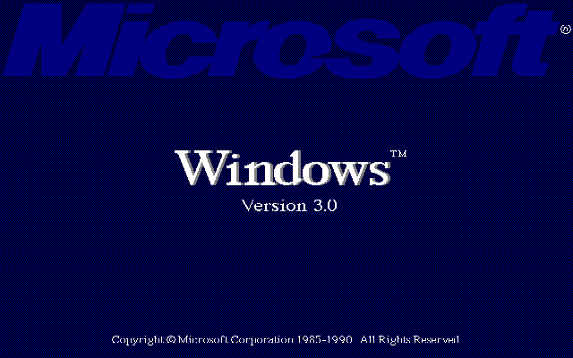

# Windows 3.0 EGC Driver

A **640x400, 16-colour** display driver for Microsoft Windows 3.0 on the
**Olivetti Enhanced Graphics Controller (EGC)** and **AT&T Display Enhancement
Board (DEB)**. It supports the Olivetti M28, also known as the AT&T PC 6310.

## Download

Download **EGC30A2.ZIP** from the [Releases page](https://github.com/retrogcom/windows-3.0-egc/releases).
It contains the compiled driver, native colour startup components, Windows
Setup installer, backup/restore utilities and M28 compatibility patch.
**EGC30SRC.ZIP** contains the corresponding source code.

Start with [Installation](INSTALLATION.md). Read the
[M28 compatibility instructions](docs/M28.md) before using Standard mode.
The startup artwork is available in English and Norwegian; select the
preferred version in Windows Setup. Both use the same display driver.

## Requirements and compatibility

- Olivetti EGC / AT&T DEB with a compatible monitor.
- A working Windows 3.0 installation and the original DEB resident driver
  loaded in DOS. Windows and the resident driver are not included.
- DOS 3.1 or later. **DOS 3.1 has been tested on the M28 in both Windows
  real mode and Standard mode.** DOS 6.22 has also been used with the driver.
- Your Windows 3.0 font files: VGASYS.FON, VGAFIX.FON, EGAOEM.FON and HELVB.FON.
  Setup can read them from a hard-drive directory or a floppy.
- Standard mode requires suitable extended memory and its working memory
  manager configuration. Windows 386 Enhanced mode and Windows 3.1 are not
  supported by this package.

**M28 BIOS restriction:** the included M28W3 utility is intended for BIOS
1.08. Do not apply it to BIOS 2.12. It checks DOSX.EXE compatibility but does
not identify the BIOS automatically. See [M28.md](docs/M28.md).

## Features

- Sixteen-colour GDI drawing, including text, borders, fills, lines, bitmaps
  and device-independent bitmaps.
- Native EGC colour startup and restoration to DOS text on exit.
- Software mouse cursor with drawing exclusion and save/restore support.
- Normal Windows DOS Setup installation, including system-font selection.
- Backup and restoration of SYSTEM.INI, WIN.INI and WIN.COM.

## Help and source

- [Installation and recovery](INSTALLATION.md)
- [M28 patch and BIOS compatibility](docs/M28.md)
- [Compatibility and troubleshooting](docs/COMPATIBILITY.md)
- [Building from source](BUILDING.md)
- [Rendering architecture](docs/ARCHITECTURE.md)

For a bug report, include the release version, computer and BIOS version,
DOS/Windows versions, real or Standard mode, and what you were doing. Attach
relevant EGC16.LOG lines after exiting Windows normally and a photo for
visual defects. Remove personal information before posting logs.

## Licence

Original project code and documentation are **GPL-2.0-only**, copyright
(c) 2026 **retrogcom**. See [LICENSE](LICENSE). Distributed modified versions
must provide corresponding source under GPLv2; private modifications do not
have to be published. See [third-party notices](THIRD_PARTY.md) for the
Microsoft startup artwork and Windows resource files.
